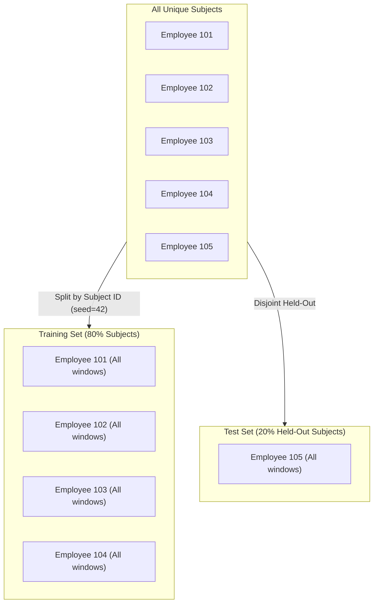

# Activity Pattern Validation and Machine Learning Export

This document details the activity pattern validation framework, the robust per-person feature normalization pipeline, and the zero-leakage subject-grouped validation splitter implemented for the Employee Data Collector (EDC).

---

## 1. Scripted Activity Pattern Validation

To guarantee that the metric calculation algorithms respond predictably to distinct behavioral states, synthetic activity event streams are passed through the real calculation pipeline (`accumulate_window_blocks` &rarr; `compute_rollup_15min_metrics`).

Validation is automated via [scripts/validate_activity_patterns.py](file:///d:/FLAME_UG/UG4/IMP_Data/employee-data-collector/scripts/validate_activity_patterns.py):

```powershell
& "agent\.venv\Scripts\python.exe" scripts/validate_activity_patterns.py
```

### Verified Scenarios:

```
======================================================================
  EDC Activity Patterns Metric Pipeline Validation
======================================================================

[TEST 1/3] Typing Speed Pattern (Fast vs. Slow)
  Fast Typing: Target=90.0 WPM | Measured=90.9 WPM | Flight Time=132.7 ms
  Slow Typing: Target=25.0 WPM | Measured=25.0 WPM | Flight Time=481.5 ms
  Delta: +65.9 WPM (Flight time ratio: 3.63x)
  --> STATUS: PASSED (WPM increased and flight time decreased as expected)

[TEST 2/3] Correction Pattern (Clean vs. Heavy Corrections)
  Clean Typing: Total Corrections=2 | Backspaces=2 | Correction Ratio=0.011
  Heavy Typing: Total Corrections=113 | Backspaces=113 | Correction Ratio=0.443
  Delta: +111 corrections | +0.432 ratio
  --> STATUS: PASSED (Corrections, backspaces, and correction ratio increased)

[TEST 3/3] Mouse Dynamics Pattern (Smooth vs. Jitter)
  Smooth Tracking: Distance=1337.2 px | Speed=44.7 px/s | Accel=0.0 px/s²
  Mouse Jitter:    Distance=65983.3 px | Speed=2221.7 px/s | Accel=7871.2 px/s²
  Speed Ratio: 49.68x | Distance Ratio: 49.35x
  --> STATUS: PASSED (Distance, speed, and acceleration increased as expected)
```

1. **Typing Speed Pattern (`evaluate_typing_speed`)**:
   - Asserts that fast typing (90 WPM) yields significantly higher measured gross/net WPM and lower median flight time than slow typing (25 WPM).
2. **Correction Pattern (`evaluate_heavy_corrections`)**:
   - Asserts that error bursts and repeated backspacing significantly elevate `total_correction_keys`, `backspace_count`, and `correction_ratio`.
3. **Mouse Dynamics Pattern (`evaluate_mouse_jitter`)**:
   - Asserts that erratic mouse jitter produces dramatically higher pointer distance, average speed, and acceleration than smooth linear tracking.

---

## 2. Robust Per-Person Normalization (Rolling Median & MAD)

In affective computing and longitudinal behavioral monitoring, baseline differences across individuals (e.g. naturally fast vs. slow typists) introduce high inter-subject variance that confounds machine learning models.

To eliminate individual baseline bias without distorting daily variance, features are scaled per person using **Rolling Median and Median Absolute Deviation (MAD)**:

### Robust Scaling Formulation:
$$\text{median}_w = \text{median}(x_{t-W+1:t})$$
$$\text{MAD}_w = \text{median}\left(\left|x_{t-W+1:t} - \text{median}_w\right|\right)$$
$$z_t = \frac{x_t - \text{median}_w}{1.4826 \times \text{MAD}_w + \epsilon}$$

Where:
- $W$ is the sliding lookback window (default: 7 observations/days).
- $1.4826$ is the standard scale factor ensuring asymptotic consistency with normal standard deviation.
- $\epsilon = 1\times 10^{-6}$ prevents division by zero when an individual's metric remains constant.
- **Causality Guarantee**: For any observation at time $t$, baseline parameters are computed strictly from observations $\le t$. Future observations are never used.

### Subject Isolation Guarantee:
Each employee's time series is grouped independently. Alice's high-speed baseline never contaminates Bob's slower baseline.

---

## 3. Split-by-Person Validation Helper (Zero Subject Leakage)

Standard random train/test splits (e.g., standard K-Fold or random shuffle) cause severe **subject identity leakage**: the model learns to identify individual employees by their unique baseline typing traits rather than learning generalized indicators of stress, cognitive fatigue, or workload.

The EDC split helper implements strict **Group-Based Partitioning**:



### Guarantees:
- **Disjoint Subjects**: $\text{Subjects}(\text{Train}) \cap \text{Subjects}(\text{Test}) = \emptyset$.
- All rows belonging to an employee exist exclusively in either train or test, never split across both.
- Both train/test split and Group-K-Fold cross-validation generators are provided (`split_by_person` and `group_kfold_by_person`).

---

## 4. Exporting ML Datasets

### Via CLI:
```powershell
edc export-ml --output-dir ./exports --prefix edc_ml_features --window-size 7 --test-size 0.2
```

### Via Standalone Script:
```powershell
& "agent\.venv\Scripts\python.exe" scripts/export_ml_features.py --db ~/.edc/agent.db --output-dir ./exports
```

### Output Schema:
The resulting CSV contains:
1. **Metadata**: `person_id`, `timestamp`.
2. **Ground Truth Labels**: `stress`, `energy`, `workload` (from daily self-reports).
3. **Partition Flag**: `split` (`train` or `test`).
4. **Raw Numerical Features**: e.g., `gross_wpm`, `mean_flight_time_ms`, `average_speed_px_s`.
5. **Per-Person Normalized Features**: `<feature>_norm` (robust z-score), `<feature>_median`, `<feature>_mad`.
