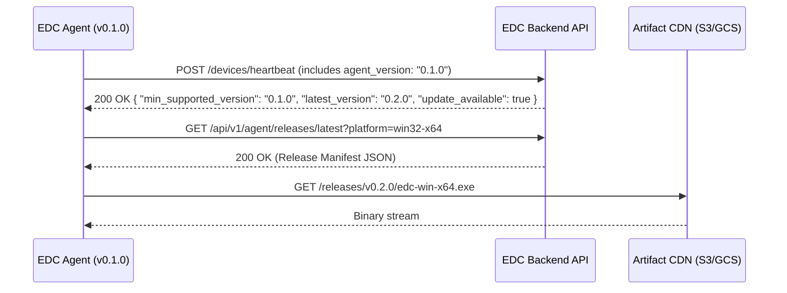

# EDC Desktop Agent Update Strategy (Architecture & Design)

> [!NOTE]
> This document specifies the architectural design for seamless, self-updating agent binaries. As specified in project requirements, this strategy is **documented for future implementation**, not currently active in code.

---

## 1. Overview and Core Requirements

The EDC desktop agent is deployed across distributed corporate employee endpoints. An automated update mechanism must satisfy five strict operational guarantees:

1. **User-Mode Execution**: Updates must execute strictly in user space without requiring Administrator / UAC prompts.
2. **Cryptographic Integrity**: Payloads must be cryptographically signed by corporate infrastructure to prevent supply-chain tampering.
3. **Atomic Binary Replacement**: Windows file locks on currently executing `.exe` binaries must be cleanly bypassed.
4. **Zero Data Loss**: In-flight 15-minute windows and un-uploaded queue batches must be safely flushed before binary replacement.
5. **Fail-Safe Rollback**: If a newly updated binary crashes or fails health verification within 60 seconds, it must automatically revert to the previous working version.

---

## 2. Update Discovery & Negotiation

The agent checks for updates via two complementary channels:



### Release Manifest Schema (`GET /api/v1/agent/releases/latest`)
```json
{
  "version": "0.2.0",
  "channel": "stable",
  "published_at": "2026-11-20T10:00:00Z",
  "min_os_version": "10.0.19041",
  "payload_url": "https://storage.edc.corp/releases/v0.2.0/edc-win-x64.exe",
  "sha256": "4a72d24b611e92d7a9b08f88c5ef...",
  "signature_ed25519": "MCowBQYDK2VwAyEA9F7...",
  "mandatory": false,
  "changelog": "Performance improvements and idle gap classification optimizations."
}
```

---

## 3. Cryptographic Verification Pipeline

Before any binary touches execution, the client must verify:

1. **Hash Verification**: Compute `SHA-256` of the downloaded `edc-win-x64.exe` and assert exact match with the manifest `sha256`.
2. **Digital Signature Verification**: Verify `signature_ed25519` against a hardcoded corporate public key embedded into the agent binary.
3. **PE Authenticode Check (Windows)**: Call Windows `WinVerifyTrust` via ctypes to ensure the executable is signed with the enterprise code-signing certificate.

If any check fails, the downloaded payload is purged immediately, an update failure alert is logged to SQLite and sent in the next heartbeat, and the running agent continues uninterrupted.

---

## 4. Windows Atomic In-Place Binary Replacement

### The Windows File Lock Challenge
On Windows, the operating system places a strict `FILE_SHARE_READ` lock on running `.exe` files (`ERROR_SHARING_VIOLATION` / `0x00000020`), preventing direct overwriting of `edc.exe` while it is running.

### The Atomic Rename Solution
While Windows prohibits overwriting an active executable, **it allows renaming an open executable within the same filesystem volume**.

#### Update Sequence:
1. **Stage**: Download and verify the new binary to `%LOCALAPPDATA%\Programs\EDC\edc.exe.new`.
2. **Drain**: Agent completes the current in-flight SQLite transaction and initiates graceful shutdown:
   - Flushes raw events in memory to SQLite.
   - Closes database connection cleanly.
3. **Swap**:
   ```cmd
   ren edc.exe edc.exe.old
   ren edc.exe.new edc.exe
   ```
4. **Spawn**: Launch the new `edc.exe` with a verification flag:
   ```cmd
   start "" "%LOCALAPPDATA%\Programs\EDC\edc.exe" run --post-update-check
   ```
5. **Exit**: The old process terminates immediately.

---

## 5. Automated Rollback & Health-Check Watchdog

When the new binary starts with `--post-update-check`:
1. It runs startup migrations via SQLite `Database.apply_migrations()`.
2. It tests platform input provider initialization (`get_platform_provider()`).
3. It performs a `/health` check against the ingestion server.
4. **60-Second Watchdog Timer**:
   - If the new process runs stably for 60 seconds without fatal crash, it removes `edc.exe.old` and marks the update **successful**.
   - If the new binary crashes during startup, an unhandled exception hook or launcher shim detects non-zero exit code:
     ```cmd
     del edc.exe
     ren edc.exe.old edc.exe
     start "" "%LOCALAPPDATA%\Programs\EDC\edc.exe" run
     ```
   - This guarantees that a bad release or corrupted update automatically restores the user's previously working agent.

---

## 6. Database Forward and Backward Compatibility

- **Forward Migration**: The existing SQLite schema manager in `Database` uses incremental integer migration versions (`schema_version` table). Every version can safely apply additive changes (`ALTER TABLE ADD COLUMN`, `CREATE INDEX IF NOT EXISTS`).
- **No Destructive Drops**: New schemas must never remove or rename existing columns without multi-version deprecation periods to allow safe rollback of the binary.
- **Rollup Compatibility**: The ingestion server uses Pydantic JSON validation with `extra="ignore"` or versioned schemas (`schema_version="1.0.0"`), guaranteeing backward compatibility across agent versions.
